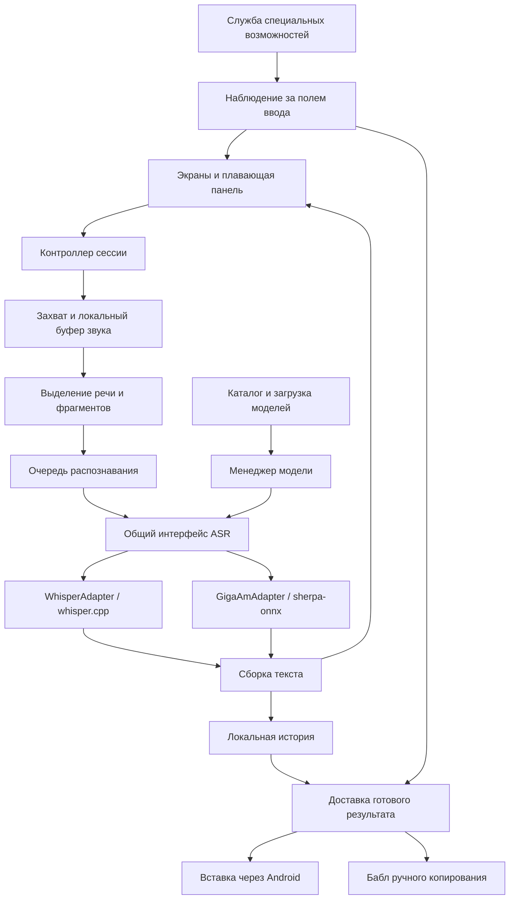

# Lacan — архитектура первой версии

Дата: 20 октября 2026 года.

Статус: принята пользователем как основа реализации локальной альфы 20 октября 2026 года. Фактические результаты испытаний и ограничения реализации — в `docs/local-testing.md`.

Язык приложения на первом этапе: русский. Проект — свободное программное обеспечение под GNU GPLv3 (`GPL-3.0-only`); разработка публикуется на GitHub.

## 1. Назначение и границы

Lacan — Android-приложение для локальной голосовой диктовки в текстовые поля других приложений. Пользователь сохраняет привычную клавиатуру. Плавающая кнопка Lacan появляется при доступном текстовом вводе, запускает запись и позволяет завершить её повторным нажатием. Во время записи панель показывает предварительное распознавание. Окончательный текст вставляется в активное поле либо становится доступен для ручного копирования.

Аудио и расшифровки не отправляются на сервер. Интернет используется для явно запрошенного скачивания моделей. Счёт, облачная синхронизация, аналитика и удалённое распознавание не нужны.

### Обязательный состав первой версии

- Диктовка продолжительностью до 10 минут включительно.
- Русская, английская и смешанная речь, включая английские технические термины внутри русских предложений.
- Whisper и GigaAM: обе интеграции реализуются и испытываются в первой версии. GigaAM не откладывается на следующий выпуск.
- Расшифровка с пунктуацией. Отдельного удаления слов-паразитов, литературного редактирования, перефразирования и перевода нет.
- Предварительный текст в бабле; он может запаздывать и изменяться.
- Плавающая перемещаемая кнопка с сохранением положения, включая положение поверх микрофона привычной клавиатуры.
- Продолжение диктовки при переключении приложений и потере фокуса.
- Остановка записи при блокировке экрана.
- Вставка в поле, активное при готовности окончательного результата.
- Бабл с предложением копирования, если автоматическая вставка невозможна.
- Локальная история последних 100 непустых результатов, содержащая текст, а не аудиозаписи.
- Мастер настройки разрешений и каталог проверенных моделей с загрузкой на телефон.

### За пределами первой версии

Часовые сессии, запись при заблокированном экране, собственная клавиатура, редактор на основе языковой модели, произвольные модели с Hugging Face, синхронизация, хранение аудио в истории, голосовые команды и расширенная настройка цвета, формы и иконки кнопки.

Поддержка часа учитывается устройством буферов и очереди, но не объявляется готовой без длительных испытаний. Автоматическая пунктуация и написание терминов остаются результатом распознавания и не гарантируются безошибочными. Алгоритм Lacan не должен специально удалять произнесённые повторы и слова-паразиты.

## 2. Платформа и тестовые устройства

Предлагаемая минимальная версия — Android 13 / API 33. Она позволяет использовать API ввода текста службы специальных возможностей [1]. Основная сборка для физических устройств — arm64-v8a. Дополнительная архитектура эмулятора выбирается под машину разработки.

Основное устройство — Samsung Galaxy A56. Пользователь сообщил Android 17; перед испытаниями фиксируются фактические Android API, версия One UI, объём памяти и номер сборки. Это данные тестовой среды, а не предположение о состоянии всех A56.

LG Velvet 5G пользователя работает на Android 12. Он не входит в обязательную матрицу первой версии. Обновление телефона или обход ограничений его прошивки не являются задачами Lacan. При необходимости отдельная исследовательская сборка сможет проверить на нём распознавание без обещания системной интеграции.

Эмулятор используется для проверки интерфейса, переходов состояний и поведения на минимальной версии Android. Скорость локального распознавания, нагрев, расход батареи и особенности Samsung проверяются на A56.

## 3. Пользовательские сценарии

### 3.1. Первое включение

1. Приложение объясняет назначение доступа к микрофону, специальным возможностям и плавающей панели.
2. Пользователь выдаёт необходимые разрешения через системные экраны.
3. Выбирает и скачивает хотя бы одну совместимую модель. До скачивания видны размер, назначение и языковые ограничения.
4. Lacan проверяет целостность файлов и возможность загрузить модель.
5. Пользователь выполняет пробную диктовку, после чего включается работа в других приложениях.

Отказ в разрешении не создаёт бесконечный цикл запросов: соответствующая функция остаётся недоступной, а главный экран показывает причину и действие для исправления.

### 3.2. Обычная диктовка

В состоянии ожидания кнопка появляется при фокусе в подходящем поле и видимой экранной клавиатуре. Сам фокус и видимость клавиатуры проверяются раздельно. Скрытие клавиатуры в ожидании скрывает кнопку. Поддержка сценария только с физической клавиатурой не является критерием первого выпуска.

Нажатие запускает запись. Если модель ещё не готова, звук уже принимается, а панель показывает подготовку модели. Запись считается начавшейся только после успешного запуска микрофона.

Кнопка становится кнопкой остановки и остаётся на привычном месте. Панель раскрывается по доступной ширине экрана: кнопка отмены, бабл с текстом, кнопка остановки. При размещении у противоположного края направление раскрытия меняется. Учитываются системные отступы и границы экрана.

Предварительный текст прокручивается к последним словам. Изменяемый конец допускает исправления. До завершения никакие промежуточные результаты в чужое поле не вставляются.

После нажатия «Стоп» микрофон освобождается сразу. Панель сворачивается к основной кнопке; до завершения обработки на ней отображается прогресс без выдуманного процента. Нажатие на эту кнопку во время обработки открывает действие отмены; отмена доступна также в уведомлении. Когда результат готов, он сначала сохраняется в историю, затем предпринимается одна попытка вставки.

### 3.3. Переключение приложений

Диктовка продолжается при потере фокуса, закрытии клавиатуры и переходе в другое приложение. Пока идёт запись, панель управления остаётся доступной, даже если подходящего поля нет. На экранах, где Android ограничивает overlay, остаётся системное уведомление с действиями остановки и отмены.

Исходное поле не является обязательным адресатом. Непосредственно перед вставкой определяется текущее активное поле. Пользователь может начать диктовку в одном месте, проверить информацию в другом и выбрать поле назначения к моменту завершения.

Lacan не нажимает «Отправить», не подтверждает формы и не переводит фокус самостоятельно.

### 3.4. Вставка и ручное копирование

Вставка выполняется в позицию курсора; выделенный фрагмент заменяется по стандартной семантике ввода. Весь существующий текст поля не заменяется. Если нельзя безопасно выполнить такую операцию, используется ручное копирование.

Перед операцией повторно проверяются окно, поле и доступность соединения ввода. При изменении адресата между проверкой и операцией попытка прекращается. Поля Lacan и его панели не считаются внешним адресатом. Пароли, недоступные и явно неподходящие поля не используются для автоматической вставки.

Если поля нет, оно отказало во вводе либо результат операции неясен, рядом с основной кнопкой появляется бабл: начало текста, короткое пояснение, «Копировать» и закрытие. Буфер обмена меняется только по явному нажатию. Неясный результат не вызывает повторной автоматической попытки, которая могла бы удвоить текст.

Закрытие бабла не удаляет историю. Бабл результата может отображаться без активного поля и клавиатуры: правило скрытия кнопки в ожидании не должно скрывать ещё не закрытый результат. Начало следующей диктовки убирает предыдущий бабл, но результат остаётся в истории. Окончательный текст после показа бабла не вставляется автоматически при последующем появлении поля.

### 3.5. Блокировка экрана и другие остановки

Блокировка прекращает захват звука и запрещает автоматическую вставку для этой сессии. Уже записанное обрабатывается и сохраняется в историю; после разблокировки запись не возобновляется сама. Текст не показывается на экране блокировки.

Для первой версии выключение экрана также трактуется как остановка. Это предлагаемое консервативное правило реализации: оно исключает незаметное продолжение записи при погасшем экране и может быть изменено после согласования следующего режима работы.

Достижение 10 минут вызывает обычную остановку с завершением обработки. Потеря доступа к микрофону или захват микрофона другим приложением приводит к остановке с пояснением; уже полученный результат сохраняется как прерванный. При системном прерывании автоматическая вставка не производится.

«Отмена» отличается от остановки: дальнейшие результаты данной сессии игнорируются, временное аудио и черновик удаляются, итоговая запись истории не создаётся.

## 4. Состав архитектуры

Предлагаемый стек: Kotlin, Jetpack Compose для экранов, Android Views/Compose для панели с корректным жизненным циклом, coroutines и Flow для событий, Room для истории, DataStore для настроек, NDK/JNI для нативных движков. Конкретные совместимые версии зависимостей закрепляются при реализации.

| Компонент | Ответственность | Что ему не поручается |
|---|---|---|
| UI / OverlayController | Кнопки, позиция панели, предварительный текст, состояния и ошибки | Захват звука и вычисления модели |
| DictationCoordinator | Жизненный цикл сессии, команды, причины остановки, отмена | Конкретный алгоритм нейросети |
| AudioCapture | AudioRecord, временные отметки, формат и непрерывная доставка аудио | Вставка текста |
| AudioSpool | Ограниченный буфер памяти и приватный временный файл | Постоянная аудиоистория |
| Segmentation / RecognitionScheduler | Границы фрагментов, приоритеты, очередь, контроль отставания | Переписывание распознанной речи |
| AsrEngine / адаптеры | Подготовка движка, распознавание, возможности модели | Android-поля и буфер обмена |
| ModelManager | Загрузка, удержание, выгрузка выбранной модели | Управление историей |
| TranscriptAssembler | Стабильные фрагменты, изменяемый конец, обработка перекрытий | Удаление смысловых повторов и слов-паразитов |
| InputTargetTracker / TextDelivery | Поиск текущего поля, одна попытка вставки, результат доставки | Запуск модели |
| HistoryRepository | Атомарное сохранение, лимит 100, чтение, удаление | Хранение голоса |
| ModelRepository | Проверенный каталог, скачивание, хеши, лицензии и файлы | Выполнение удалённого кода модели |

Это логические границы. На старте они могут быть пакетами одного приложения с отдельными нативными библиотеками; создавать отдельный Gradle-модуль для каждого класса не требуется. Тестируемое ядро сессии и сборки текста отделяется от Android API.

## 5. Жизненный цикл сессии

Основные состояния: `Idle → Starting → Recording → Finalizing → Delivering → Idle`.

`Starting` включает получение доступа к микрофону. Подготовка модели идёт независимо: в `Recording` звук уже принимается, даже если распознавание ещё ожидает готовности модели. `Finalizing` никогда не продолжает захват микрофона.

Из активных состояний возможна отмена. Ошибка либо завершает сессию с сохранением доступного текста, либо, если текста нет, возвращает готовность с понятным сообщением. Бабл копирования — отдельное состояние интерфейса, которое не удерживает микрофон или модель в работе.

Каждая сессия получает уникальный идентификатор. Все задания и результаты содержат этот идентификатор и номер фрагмента. Поздний ответ после отмены или после начала другой сессии не может обновить панель, историю или поле ввода новой сессии.

Одновременно принимается только одна диктовка. До окончания финализации новая запись не запускается; пользователь видит обработку и может отменить её. Это ограничение первой версии предотвращает конкуренцию двух записей за один движок.

Сохранение результата идемпотентно по идентификатору сессии. Повторный callback не создаёт вторую запись истории. Автоматическая доставка допускается один раз и не повторяется после перезапуска процесса.

## 6. Звук, фрагменты и предварительное распознавание

### 6.1. Представление звука

Внутренний формат первой версии — моно PCM 16 кГц, 16 бит. При необходимости производится ресемплинг входа; формат для конкретного движка преобразуется в адаптере. Опорная шкала времени — номера аудиосэмплов, чтобы границы не зависели от задержек интерфейса.

Небольшие блоки от AudioRecord поступают в ограниченный буфер и приватный временный файл. Рабочие окна читаются из этого хранилища. Весь звук не удерживается как растущий массив в RAM. Моно PCM указанного формата занимает примерно 19,2 МБ за 10 минут и 115,2 МБ за час без учёта заголовков; рабочая память модели учитывается отдельно.

Для простоты первая версия может сохранять временный файл всей текущей сессии до успешного сохранения результата. После финализации либо отмены файл удаляется. Таким образом аудио временное, но при отставании очереди оно не теряется.

### 6.2. Два вида работы

**Окончательная обработка фрагментов** обязательна: покрывает всю записанную речь по порядку. **Предварительная обработка текущего конца** необязательна: обновляет бабл и может пропускаться при нагрузке. Эти задачи используют одну выбранную модель, а не две одновременно загруженные модели.

Уже принятые фрагменты накапливаются в итоговом тексте. Предварительный конец заменяется новым предположением. После «Стоп» обрабатываются оставшиеся фрагменты и последний конец; повторный проход по всей записи по умолчанию не выполняется.

Whisper в таком режиме использует движущиеся окна и повторное распознавание контекста; это не обещание встроенного потокового состояния модели [2]. Политика окон определяется адаптером, а пользовательский интерфейс не зависит от неё.

### 6.3. Стартовые параметры для испытаний

Это проверяемые настройки прототипа, а не обещание качества или задержки:

- Локальный детектор речи Silero VAD; его файлы проходят ту же проверку целостности и лицензии, что и ASR-модели.
- Кандидат на естественную границу — около 600 мс тишины после речи.
- Предельное окно ASR — 20 секунд вместе с контекстом для первых адаптеров; адаптер вправе задавать меньший предел. Так не превышается документированное ограничение короткого вызова GigaAM [3].
- Перекрытие на принудительной границе — исходно около 0,75 секунды.
- Предварительное окно — до 8 секунд; попытка обновления не чаще раза в 2 секунды, только если есть вычислительный запас.
- Добавляется небольшой контекст перед обнаруженным началом речи, чтобы VAD не отрезал начальные звуки.

При непрерывной речи фрагмент закрывается по пределу длины, даже если пауз нет. При отключённом или отказавшем VAD возможна обработка по ограниченным окнам; функция не должна зависеть от идеальной работы детектора.

Дубликаты удаляются только на известном временном перекрытии соседних окон. При наличии временных отметок используются они; иначе — ограниченное сопоставление суффикса и префикса внутри зоны перекрытия. Нельзя удалять повторяющиеся слова во всём тексте: произнесённое «да, да» должно сохраняться. Неуверенные стыки не становятся поводом для смыслового редактирования.

### 6.4. Очередь и отставание

Захват аудио, UI и нативное распознавание работают независимо. Вызовы одного экземпляра движка сериализованы. Окончательная обработка имеет приоритет над обновлением предварительного конца; устаревшие preview-задания объединяются или удаляются, обязательные аудиофрагменты не пропускаются.

Измеряются длительность аудио в очереди и отношение времени обработки к длительности звука. Если модель не успевает, сначала прекращаются лишние preview-проходы. Скрытого переключения на другую модель нет. Пользователь получает сообщение об отставании и возможность выбрать более лёгкую модель для следующей диктовки.

При нехватке места или невозможности сохранить следующий блок запись останавливается с сохранением доступного результата. Бесконечная очередь в памяти недопустима.

## 7. Модели и движки

### 7.1. Решение первой версии

Базовый вариант — два адаптера за одним интерфейсом:

- `WhisperAdapter`: whisper.cpp, многоязычные tiny/base/small, первоначально варианты Q5. Base — кандидат по умолчанию до испытаний; модель для рекомендаций выбирается по качеству русского и смешанной речи и скорости на A56.
- `GigaAmAdapter`: sherpa-onnx с совместимым ONNX-экспортом GigaAM. Предпочтительный кандидат — GigaAM v3 e2e с пунктуацией. Конкретный CTC/RNNT-артефакт выбирается в ранней проверке совместимости. GigaAM v2 может быть контрольной моделью для сравнения, но не подменяет проверку пунктуации кандидата для выпуска [3, 4].

GigaAM запускается на A56 уже в первом исследовательском этапе. Если выбранный экспорт не совместим с библиотекой или не даёт пунктуацию, это блокирующая проблема интеграции, а не основание незаметно убрать GigaAM из объёма первой версии. В таком случае проверяется другой поддерживаемый экспорт; изменение движка документируется до реализации зависимых частей.

Возможность обслужить обе модели одной библиотекой sherpa-onnx сохраняется как вариант упрощения. Менять базовое решение стоит только после сравнения на одинаковом аудио: скорость, качество, память, пунктуация и сложность сборки. Архитектура не зависит от числа библиотек.

Каждая модель имеет объявленные языки и возможности. Whisper обеспечивает основной путь для русского, английского и смешанной речи. Поддержка английского не приписывается русскоязычной GigaAM только на основании общего интерфейса. До результатов тестов её карточка обозначает русский как целевой язык, а смешанную речь — как непроверенную.

### 7.2. Контракт адаптера

Адаптер предоставляет подготовку модели, описание возможностей, обработку ограниченного аудиофрагмента, завершение/отмену работы и освобождение ресурсов. Возможности включают языки, пунктуацию, предел длины окна, контекст и доступность временных отметок.

Результат содержит идентификатор сессии и фрагмента, интервал исходного аудио, текст, необязательные временные отметки и диагностические показатели времени. Отсутствующие временные отметки или уверенность не выдумываются.

Модель не получает доступ к Android-полям, истории или сети. Вставка выполняется исключительно слоем Android после завершения сборки текста.

### 7.3. Языки и пунктуация

Для Whisper доступны «Автоматически», «Русский», «Английский». Режим закрепляется за сессией; язык не переопределяется независимо на каждом коротком фрагменте. В автоматическом режиме оценка делается по достаточно длинному участку речи с возможностью пересмотра в рамках политики адаптера. Режим задачи — транскрипция, не перевод.

Распознавание смешанной речи и написание терминов проверяются отдельно от общей ошибки распознавания русского. Выбор языка не является гарантией сохранения любых английских написаний.

Используется пунктуация самой ASR-модели. Отдельная языковая модель для редактирования в первую версию не включается. Нормализация, встроенная в выбранную ASR-модель, объясняется в её карточке: отсутствие отдельного редактора не означает абсолютно буквальную передачу всех особенностей речи.

## 8. Жизненный цикл модели

Модель и диктовка имеют независимые жизненные циклы. `ModelManager` знает состояния `Unloaded`, `Loading`, `Ready`, `Busy`, `Failed`.

Выбранная модель предварительно загружается после включения Lacan или выбора модели. Она остаётся в памяти между диктовками. В первой версии нет обязательного таймера выгрузки после каждой записи или короткого простоя.

Причины выгрузки: явное отключение Lacan, смена модели в ожидании, нехватка памяти, завершение процесса системой. Одновременно удерживается одна ASR-модель; VAD и служебные буферы учитываются отдельно. Смена модели во время записи или финализации недоступна.

Постоянное присутствие модели в RAM не гарантируется. Бездействующий сервис не удерживается в foreground только ради сохранения модели. После утраты процесса возможен холодный запуск. Если модель грузится, разрешённый захват аудио уже работает и сохраняет начало фразы; при ошибке загрузки запись останавливается с сообщением.

Первый этап использует CPU. Ускорение на GPU/NPU рассматривается после замеров и не предполагается автоматически доступным только из-за наличия соответствующего блока в телефоне. Medium и более крупные модели не входят в обязательный каталог первого выпуска, но не требуют изменения общего контракта.

## 9. Android-интеграция и разрешения

`AccessibilityService` отслеживает события фокуса и доступные окна. Получение дерева интерфейса ограничивается нужным полем и контекстом окна. Полный текст экранов не записывается в логи или историю. Служба остаётся независимой от сессии микрофона.

Основной путь ввода на Android 13+ — API ввода службы специальных возможностей. Устаревший узел UI не хранится как долговечный адресат. Перед доставкой заново определяется активное поле и проверяется соединение [1].

Для плавающей панели первоначально используется обычное application overlay с явным разрешением пользователя. Это соответствует сценарию свободно перемещаемой кнопки. Accessibility overlay рассматривается только если испытание покажет преимущество без нарушения поведения; замена типа окна не считается решением ограничений микрофона сама по себе.

| Механизм | Назначение |
|---|---|
| `RECORD_AUDIO` | Разрешение пользователя на микрофон |
| `FOREGROUND_SERVICE`, `FOREGROUND_SERVICE_MICROPHONE`, тип `microphone` | Сервис активной записи и системная видимость этой работы |
| `POST_NOTIFICATIONS` | Уведомление записи с остановкой/отменой; отказ обрабатывается согласно Android |
| `SYSTEM_ALERT_WINDOW` | Обычная плавающая панель поверх приложений |
| Служба с защитой `BIND_ACCESSIBILITY_SERVICE` | Подключение службы самой системой; пользователь включает службу в настройках, это не обычный runtime-запрос |
| `INTERNET` | Явная загрузка моделей по HTTPS |

Широкое разрешение на доступ ко всем файлам не требуется: модели, база и временное аудио находятся в приватном хранилище приложения.

### Критическая проверка запуска микрофона

На новых Android возможность показать overlay и возможность запустить microphone foreground service из фона регулируются отдельно. Наличие `SYSTEM_ALERT_WINDOW` нельзя считать достаточным для записи [5].

До разработки основного интерфейса выполняется проверка реального сценария: касание плавающей кнопки поверх чужого приложения, разрешённый запуск микрофона, сохранение/возврат фокуса, продолжение после смены приложения, остановка на блокировке.

Если для разрешённого запуска необходима видимая Activity Lacan, проверяется минимальный пользовательский переход с возвратом в исходное приложение. Прозрачное окно не объявляется способом обхода системных требований. Если механизм требует второго постоянного действия или нарушает ожидаемое поведение кнопки, изменение UX согласуется до дальнейшей реализации.

Запись сопровождается обязательным уведомлением foreground service. Его видимость в шторке зависит в том числе от разрешения уведомлений. Если панель скрыта системой и доступного пользователю управления записью через уведомление нет, Lacan завершает запись с сохранением результата; продолжать запись без доступной остановки нельзя. На блокировку и потерю ресурса микрофона система сессии реагирует независимо от доступности панели. Особенности фоновых ограничений Samsung включаются в мастер настройки только после воспроизведения, без требования заранее отключить все ограничения батареи.

## 10. История и приватность

История хранится локально в Room. Запись содержит `id`, время начала и завершения, длительность, окончательный текст, модель, выбранный языковой режим, причину завершения и статус доставки. Она не содержит аудио или копии окружающего содержимого чужого поля.

В одной транзакции сохраняется результат и удаляются старые записи сверх лимита 100. Порядок — по времени завершения. Пустой результат и явная отмена в историю не добавляются. Полные и прерванные непустые результаты учитываются в одном лимите.

Для защиты от сбоя стабильные фрагменты текста периодически сохраняются в локальном черновике сессии. После аварийного завершения процесса при следующем запуске непустой черновик предлагается как прерванный результат в истории. Нераспознанный звук не восстанавливается автоматически; оставшиеся временные аудиофайлы очищаются. Поэтому гарантируется сохранение уже зафиксированного текста, а не всей записи при принудительном завершении процесса.

История поддерживает просмотр, копирование, удаление одной записи и очистку всех. Удаление истории не отменяет уже выполненное копирование в системный буфер — эти хранилища независимы.

База, черновики, временное аудио и скачанные модели исключаются из системного облачного резервного копирования и переноса данных средствами backup. Аналитика и автоматическая отправка отчётов отключены. Логи не содержат аудио, расшифровок и содержимого чужих полей. Для диагностики допустимы версии, длительности, коды ошибок и размеры очереди без текста.

Интернет-доступ технически есть у приложения для скачивания; обещание локальности обеспечивается устройством кода, отсутствием сетевых вызовов в тракте распознавания и проверкой трафика. Работа после скачивания проверяется в авиарежиме. Хост загрузки неизбежно получает обычный запрос на файл модели; голос и расшифровка в него не включаются.

## 11. Каталог моделей

Каталог первой версии поставляется с приложением и содержит ограниченный список проверенных артефактов. Для каждого фиксируются источник и версия, движок, формат, файлы, размеры, SHA-256, лицензия, языки, пунктуация и требования совместимости.

Загрузка идёт во временное место. Модель становится доступной только после получения всех файлов и проверки хешей; прерванная загрузка не заменяет рабочую модель. Удаление выбранной модели требует предварительно снять её с использования. Сами веса скачиваются отдельно от APK, по выбору пользователя.

Исполняемые Python-файлы из репозиториев моделей не загружаются и не запускаются на телефоне. Конвертация и подготовка ONNX/GGML выполняются при подготовке проверенного артефакта для каталога. Лицензии проверяются для конкретных весов и зависимостей; открытость движка не заменяет лицензию модели.

Владелец выбрал GNU GPLv3. Для исходного кода и документации Lacan используется `GPL-3.0-only`; текст лицензии находится в корневом файле `LICENSE`. Уведомления и условия лицензий сторонних библиотек и модельных артефактов сохраняются отдельно. Совместимость конкретных зависимостей проверяется до включения в распространяемую сборку.

Разработка ведётся публично на GitHub: архитектура, планы, исходный код, инструкции сборки и результаты проверок. Репозиторий не содержит секретов, ключей подписи, личных записей, истории диктовок и скачанных весов. APK и исходники выпусков будут публиковаться после появления проверяемой сборки; текущая архитектура не объявляется готовым приложением.

## 12. Проверка перед выпуском

### Обязательные технические испытания в начале реализации

1. Плавающая кнопка, разрешённый запуск микрофона и вставка на A56 и Android 13 в эмуляторе.
2. Реальный запуск Whisper и GigaAM на A56 на одинаковых записях; GigaAM проверяется также на пунктуацию.
3. Русский, английский, смешанная речь, технические термины, паузы и намеренные повторы.
4. Стыки фрагментов: обрезанные слова, перекрытия, отсутствие двойной вставки и потерянных частей.
5. Непрерывные 10 минут с измерением отставания, времени до финального результата, памяти и нагрева.

Не задаём неподтверждённое обещание вроде «любая модель отвечает за секунду». Результаты холодного запуска, повторного запуска, времени первого preview и задержки после остановки фиксируются раздельно. Если модель стабильно медленнее речи, это отражается в её статусе; нельзя называть её пригодной для комфортной диктовки только потому, что она завершает короткий тест.

### Матрица приёмки

| Сценарий | Ожидаемый результат |
|---|---|
| Обычное поле заметок, мессенджера, браузерной формы | Вставка в курсор, окружающий текст сохранён |
| Выделенный текст | Заменяется только выделение |
| Уход в другое приложение и возвращение | Запись не прерывается; результат попадает в активное поле при готовности |
| Другое подходящее поле при завершении | Оно используется как адресат без требования совпадения с исходным |
| Нет поля, отказ или неясный исход вставки | Бабл копирования, результат в истории, нет автоматического изменения буфера |
| Смена поля в момент доставки | Нет повторной неконтролируемой вставки; используется fallback |
| Блокировка/выключение экрана | Микрофон остановлен; результат сохраняется; после разблокировки нет автоматической вставки |
| Отмена во время записи или финализации | Нет итоговой вставки и новой записи истории; поздние callbacks игнорируются |
| Холодная модель | Звук принимается после разрешённого запуска микрофона; начало фразы не теряется из-за загрузки |
| Следующая диктовка | Готовая модель переиспользуется, если процесс и ресурсы сохранились |
| 10 минут речи | Нет неограниченного роста RAM, пропуска аудио или молчаливого обрезания результата |
| Тишина | Нет искусственного текста, порождённого обработкой чистой тишины |
| Авиарежим после скачивания | Запись, распознавание, история и вставка работают |
| 101 непустой результат | В истории остаются последние 100 |
| Завершение процесса системой | Нет автоматического возобновления микрофона или повторной вставки; восстановим сохранённый текст черновика |
| Поворот, изменение клавиатуры и масштаба | Панель остаётся доступной в пределах экрана; позиция кнопки восстанавливается корректно |

Ядро переходов состояний, отмена, история, очередь и сборка перекрытий проверяются автоматическими тестами. Системные разрешения, клавиатуры, реальная вставка, аудиопрерывания и производительность проверяются инструментальными и ручными сценариями. Тесты скорости эмулятора не используются для обещаний о телефоне.

## 13. Путь к часовой диктовке

Для расширения не нужно менять контракт между интерфейсом, аудио и движками. Уже предусмотрены ограниченная память, очередь с дисковым хранением звука, последовательная сборка текста и независимый жизненный цикл модели.

Перед увеличением лимита потребуются часовые испытания нагрева и отставания, проверка свободного места, устойчивости сервиса, сохранения длинного текста и ограничений поля назначения. Поле стороннего приложения может не принять очень большой результат; история и ручное копирование остаются обязательным запасным путём.

Запись при блокировке экрана — отдельное изменение поведения. Увеличение лимита до часа само по себе не включает такую запись.

## 14. Решения, требующие проверки, и порядок дальнейшей работы

Функциональное ядро основано на согласованных в обсуждении требованиях. Его детальные правила и технические решения представлены для проверки владельцем. В частности, стек, остановка при выключении экрана без блокировки, параметры окон, хранение черновиков, управление отменой при финализации и механизм Android-запуска являются предложениями этого документа.

Технические проверки имеют явный результат:

- **Микрофон и фокус:** разрешённый сценарий одного нажатия подтверждён на A56 либо выявлено конкретное ограничение UX, которое требуется согласовать.
- **GigaAM:** выбран совместимый артефакт, подтверждены локальный запуск, лицензия и пунктуация; при неудаче интеграция остаётся незавершённой, а не переносится молча за пределы первой версии.
- **Производительность:** измерены оба движка; выбран рекомендуемый вариант Whisper, а статус GigaAM основан на фактических результатах.
- **Стыки и языки:** тестовый набор показывает поведение смешанной речи и перекрытий; ошибки фиксируются до объявления готовности.

Следующий этап после согласования документа — отдельный план реализации с этими проверками в начале. Этот документ не подтверждает готовность кода, скорость моделей или универсальную совместимость с любым полем.

## Источники

Проверены при подготовке архитектуры; сторонние библиотеки и модельные артефакты должны закрепляться конкретными версиями при реализации.

1. [Android: API ввода службы специальных возможностей, с API 33](https://developer.android.com/reference/android/accessibilityservice/InputMethod).
2. [whisper.cpp: пример распознавания движущегося окна](https://github.com/ggml-org/whisper.cpp/blob/master/examples/stream/README.md).
3. [GigaAM: варианты v3 e2e, пунктуация, короткие/длинные записи и ONNX](https://github.com/salute-developers/GigaAM).
4. [sherpa-onnx: модели GigaAM и примеры обработки](https://k2-fsa.github.io/sherpa/onnx/pretrained_models/offline-transducer/nemo-transducer-models.html); [изменение экспорта GigaAM v3](https://github.com/k2-fsa/sherpa-onnx/actions/runs/20257970055).
5. [Android: ограничения запуска foreground service и while-in-use доступа](https://developer.android.com/develop/background-work/services/fgs/restrictions-bg-start); [типы foreground service](https://developer.android.com/develop/background-work/services/fgs/service-types).
6. [Whisper: проверяемые варианты файлов модели](https://huggingface.co/ggerganov/whisper.cpp/tree/main).
7. [Wispr Flow: пользовательский ориентир плавающей кнопки и разрешений](https://docs.wisprflow.ai/articles/8858845757). Его облачная обработка не является частью архитектуры Lacan.

## 15. Уточнения реализации локальной альфы

- CPU/arm64, Whisper.cpp1.8.7 и sherpa-onnx1.12.32. Каталог: tiny/baseQ5 и GigaAMv3 e2eCTCint8.
- Energy VAD временно реализует разрешённый выше запасной путь сегментации; Silero остаётся следующей проверкой качества границ.
- Для надёжного доступа к Стоп/Отмена альфа требует разрешённого канала уведомлений; его отключение останавливает запись. Изменение не добавляет скрытой записи или дополнительных сетевых действий.
- Запуск из панели проходит через короткую видимую Activity с возвратом в предыдущее приложение. Это разрешённый пользовательский переход, а не попытка обойти while-in-use ограничения.
- Небольшие настройки хранятся в SharedPreferences, история/черновики — в Room. Замена настроек на DataStore не является условием локального испытания.
- Результаты A56, эмулятора и прогона реальных моделей фиксируются отдельно; успешная сборка сама по себе не означает приёмку всех сценариев.
